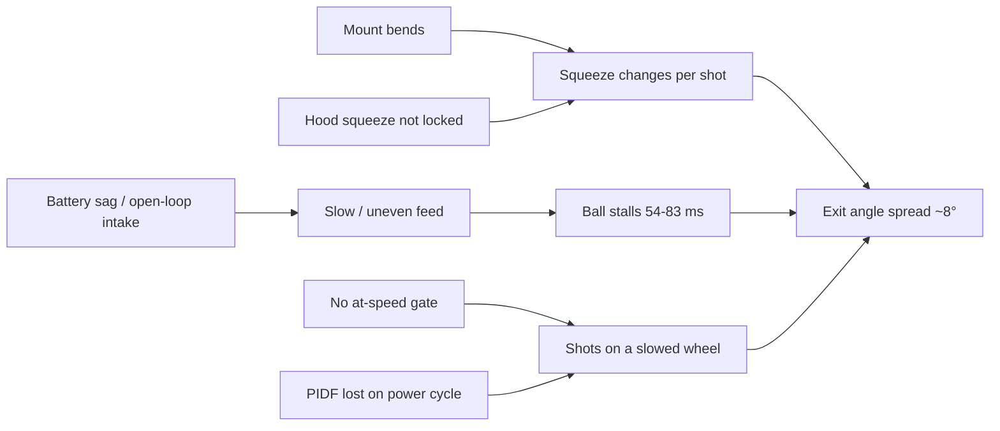

# Shooter fix list: night before competition

Back to [[FTC Home]] · Evidence: [[Shooter Video Evidence]] · Code: [[Shooter Code Review]] · Progress: [[Shooter Software Implementation Log]]

## Bottom line
The biggest problem in the video is the **ball leaving at a different angle each shot (about 8° spread)**, not the flywheel running out of speed.

Three **hardware** causes drive it:
1. The flywheel mount bends on every shot.
2. The intake pushes the ball into the flywheel slowly and unevenly.
3. Nothing holds the hood squeeze steady.

The **code** adds three more:
1. Nothing waits for the flywheel to be at speed before feeding.
2. The intake runs open loop.
3. Tuned PIDF values vanish when the hub loses power.

**Fix in this order tonight.** Each step changes what the next one tunes:
1. Stiffen the flywheel mount.
2. Set the hood squeeze and smooth the hood surface.
3. Make the feed into the flywheel fast and consistent.
4. Retune PIDF, hardcode it, and add an at-speed gate.
5. Set battery and driving rules for matches.
6. Re-film one 4-ball burst at 240 fps to confirm.

> [!warning] Big gap
> The match TeleOp and Autonomous aren't in the repo. Details and status: [[Shooter Code Review]].

## Tonight, must do: mechanical (do these FIRST)
Each one changes how hard the ball is squeezed, and the software tuning only holds if that squeeze stays the same.

- [ ] **1. Stiffen the flywheel mount**
    - In the video the motor moved 1.5–3 mm on every shot and kept wobbling about 12 times a second for over 150 ms. The gap to the hood opens in the middle of the shot.
    - The wheel looks like it hangs off the motor shaft with only a printed bracket holding the motor. Add a bearing in a plate on the far side of the wheel shaft. Brace the bracket to the chassis with a second plate or standoffs.
    - If there's printer time, reprint the bracket with thicker walls and 100% infill. **Pass test:** push the wheel toward the hood by hand and nothing visibly moves.
- [ ] **2. Lock the hood squeeze and smooth the hood**
    - Squeeze the ball firmly enough that the wheel grabs it at once, but so it still rolls through by hand. Mark the setting so it cannot drift.
    - Cover the surface the ball touches with PTFE tape or a thin polycarbonate strip so printed layer lines can't grab it.
    - Brace the hood ring so it cannot flex. (Hood flex itself couldn't be measured; the ball covers it in the video.)
- [ ] **3. Make every ball enter the flywheel the same way**
    - Each ball sat in the gap for 54–83 ms without spinning, so the wheel wasn't touching it yet. The transfer was nudging it in slowly.
    - Add a guide or ramp so each ball meets the wheel at the same spot. Make sure the last transfer wheel keeps pushing until the flywheel grabs the ball.
    - The real fix is a fast feeder roller right at the flywheel entry. Only try it tonight if it can be geared off the intake quickly.
- [ ] Tie back the loose red and black wires beside the flywheel.
- [ ] Draw a paint line across the flywheel hub and its set screw, so slipping is visible at a glance.

## Tonight, must do: software
Do these **after** the mechanical fixes, which change the load the PIDF handles. The code is already written ([[Shooter Software Implementation Log]]). The steps and numbers are in [[Shooter Tuning Guide]].

- [ ] Measure maxV (Tuning Guide step 2).
- [ ] Compute starting PIDF, then tune P under ball load (steps 2 and 4).
- [ ] Copy the final PIDF into `ShooterConfig.java`, then power-cycle and check `PIDF on hub: OK` (steps 5 and 7).
- [ ] Measure the intake encoder, or leave it at power 1.0 while shooting (step 2, hold B).

## Tonight, if time allows (in order of payoff)
Presets, precision drive, scaled F, bulk caching and CSV logging are already in code. Only the people steps are left:
- [ ] **Calibrate presets at tape marks** (Tuning Guide step 6).
- [ ] **Re-film one 4-ball burst at 240 fps**: tripod, side view, goal in frame. Compare before/after. Use 4 balls, not 5, since a match allows 4 at most (G407).
- [ ] **Try `VOLTAGE_COMPENSATE_F = true`** only if late-match shots fall short.

## At the event
See [[Pre-Match Checklist]].

## Interdependencies (why the order matters)

1. **Mount first.** A mount that bends changes the squeeze on every shot, so nothing tuned before it holds.
2. **Hood squeeze second.** More squeeze on a bending mount only adds bend.
3. **Feed third.** Feed speed sets how close together shots come, and so how fast the flywheel must recover.
4. **PIDF and the gate fourth.** Tune them with the final squeeze and feed, under real ball load.
5. **Battery and driving rules last.** They keep matches at the conditions you tuned in.

## After competition
See [[Post-Competition Redesigns]].
