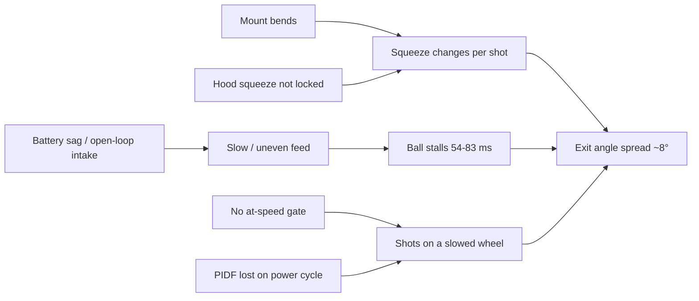

# Shooter fix list: night before competition

Back to [[FTC Home]] · Evidence: [[Shooter Video Evidence]] · Code: [[Shooter Code Review]] · Progress: [[Shooter Software Implementation Log]]

## Bottom line
The biggest problem in the video is the **ball leaving at a different angle each shot (about 8° spread)**, not the flywheel running out of speed.

Three **hardware** causes drive it:
1. The flywheel mount bends on every shot.
2. The intake pushes the ball into the flywheel slowly and unevenly.
3. Nothing holds the hood squeeze steady.

The **code** adds three more:
1. Nothing waits for the flywheel to be at speed before feeding.
2. The intake runs open loop.
3. Tuned PIDF values vanish when the hub loses power.

**Fix in this order tonight.** Each step changes what the next one tunes:
1. Stiffen the flywheel mount.
2. Set the hood squeeze and smooth the hood surface.
3. Make the feed into the flywheel fast and consistent.
4. Retune PIDF, hardcode it, and add an at-speed gate.
5. Set battery and driving rules for matches.
6. Re-film one 5-ball burst at 240 fps to confirm.

> [!warning] Big gap
> The repo only has the two tuning OpModes. The match TeleOp and Autonomous aren't in it, so every code fix has to be copied into the code you actually run tomorrow. A reference match TeleOp (`BioBuzzTeleOp`) was added tonight; see [[Shooter Software Implementation Log]].

## Tonight, must do: mechanical (do these FIRST)
Each one changes how hard the ball is squeezed, and the software tuning only holds if that squeeze stays the same.

- [ ] **1. Stiffen the flywheel mount**
    - In the video the motor moved 1.5–3 mm on every shot and kept wobbling about 12 times a second for over 150 ms. The gap to the hood opens in the middle of the shot.
    - The wheel looks like it hangs off the motor shaft with only a printed bracket holding the motor. Add a bearing in a plate on the far side of the wheel shaft. Brace the bracket to the chassis with a second plate or standoffs.
    - If there's printer time, reprint the bracket with thicker walls and 100% infill. **Pass test:** push the wheel toward the hood by hand and nothing visibly moves.
- [ ] **2. Lock the hood squeeze and smooth the hood**
    - Squeeze the ball firmly enough that the wheel grabs it at once, but so it still rolls through by hand. Mark the setting so it cannot drift.
    - Cover the surface the ball touches with PTFE tape or a thin polycarbonate strip so printed layer lines can't grab it.
    - Brace the hood ring so it cannot flex. (Hood flex itself couldn't be measured; the ball covers it in the video.)
- [ ] **3. Make every ball enter the flywheel the same way**
    - Each ball sat in the gap for 54–83 ms without spinning, so the wheel wasn't touching it yet. The transfer was nudging it in slowly.
    - Add a guide or ramp so each ball meets the wheel at the same spot. Make sure the last transfer wheel keeps pushing until the flywheel grabs the ball.
    - The real fix is a fast feeder roller right at the flywheel entry. Only try it tonight if it can be geared off the intake quickly.
- [ ] Tie back the loose red and black wires beside the flywheel.
- [ ] Draw a paint line across the flywheel hub and its set screw, so slipping is visible at a glance.

## Tonight, must do: software
These go into the match OpMode. Do them **after** the mechanical fixes, because those change the load the PIDF has to handle. Full procedure: [[Shooter Tuning Guide]].

- [ ] **Measure the shooter's real top speed (maxV)**
    - Power 1 in `RUN_WITHOUT_ENCODER` on a fully charged battery, keep the highest `getVelocity()` ([REV PIDF guide](https://docs.revrobotics.com/first-global/fgc-pid)).
    - 6000 rpm Yellow Jacket (28 CPR, ~5,400 rpm tested no-load per [ServoCity](https://www.servocity.com/5202-series-yellow-jacket-motor-1-1-ratio-24mm-length-6mm-d-shaft-6000-rpm-3-3-5v-encoder)): expect about **2,400–2,500 ticks/s**.
    - Code: `Shooter MaxV Test` OpMode does this.
- [ ] **Compute starting PIDF from maxV, then tune P**
    - F = 32767 ÷ maxV, P = 0.1 × F, I = 0.1 × P, D = 0. For maxV = 2,450: F ≈ 13.4, P ≈ 1.3, I ≈ 0.13.
    - In Shooter PIDF Tuner, feed balls at match pace. Raise P until the dip recovers fastest without overshoot that keeps ringing.
- [ ] **Hardcode the final PIDF in the match OpMode's init**
    - `shooter.setVelocityPIDFCoefficients(P, I, D, F)` right after `setMode(RUN_USING_ENCODER)`. PIDF changes [do not persist after a power cycle](https://ftc-docs.firstinspires.org/programming_resources/shared/pidf_coefficients/pidf-coefficients.html).
    - **Trap:** the tuner's values stay loaded until the hub powers off. Practice right after tuning looks better than the first match tomorrow.
    - Code: put the numbers in `ShooterConfig.java` (one place; every OpMode reads it).
- [ ] **Only feed when the flywheel is at speed**
    - Feed only while speed error < 3% of target (~45 ticks/s at 1450).
    - One intake motor and no separate feeder, so the gate pauses the intake too. Fine while shooting.
- [ ] **Put the intake on velocity control, if its encoder is plugged in**
    - At `RUN_WITHOUT_ENCODER`, power 0.8 is 0.8 of whatever the battery gives ([gm0](https://gm0-ja.readthedocs.io/ja/latest/docs/software/adv-control-system/sdk-motors.html)), so feed speed drops as the battery drains.
    - Measure intake ticks/s at 0.8 on a fresh battery, then `setVelocity()` ~20% above that while shooting. No encoder: use power 1.0 while shooting.

## Tonight, if time allows (in order of payoff)
- [ ] **Shooting presets and tape marks**: 2–3 target velocities on the d-pad, tape matching floor spots. Keep every target ≤ 80% of maxV. (Tuners used to allow up to 6,000 ticks/s, which the motor can't reach.)
- [ ] **Precision drive mode for aiming**: hold a trigger to drop drive speed to ~0.35.
- [ ] **Re-film one 5-ball burst at 240 fps**: tripod, side view, goal in frame. Compare before/after.
- [ ] **Battery-scaled feedforward**: hub F is a fraction of battery voltage. On spin-up, re-send PIDF with F × (12.5 ÷ measured voltage). Lower priority.
- [ ] **Bulk caching + loop time on telemetry**: `LynxModule` bulk caching AUTO cuts hub round trips. Low risk; test first.
- [ ] **Log flywheel speed to a file during a burst**: hub averages velocity over ~50 ms, so tuner dip numbers read smoother than reality. Compare runs to each other.

## At the event
See [[Pre-Match Checklist]].

## Interdependencies (why the order matters)

1. **Mount first.** A mount that bends changes the squeeze on every shot, so nothing tuned before it holds.
2. **Hood squeeze second.** More squeeze on a bending mount only adds bend.
3. **Feed third.** Feed speed sets how close together shots come, and so how fast the flywheel must recover.
4. **PIDF and the gate fourth.** Tune them with the final squeeze and feed, under real ball load.
5. **Battery and driving rules last.** They keep matches at the conditions you tuned in.

## After competition
See [[Post-Competition Redesigns]].
